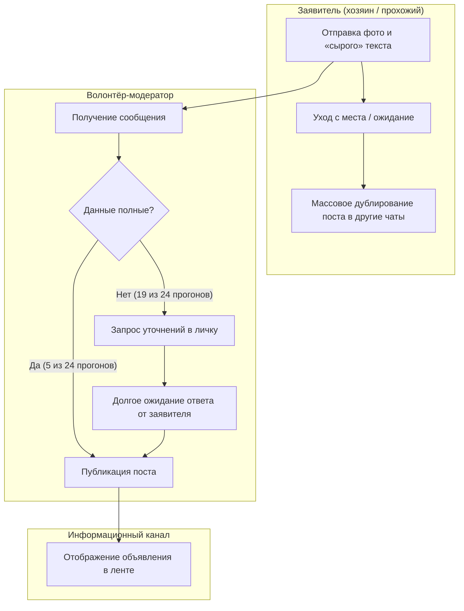

# Лабораторная работа №3. Процесс «как есть» (As-Is)

**Тема проекта:** PetID (сервис поиска пропавших животных)
**Выбранный процесс:** Обработка, модерация и публикация объявления о пропавшем или найденном животном.

---

## 1. Официальный порядок (регламент / инструкция)

* **Статус регламента:** Официальный юридический приказ отсутствует. Процесс регулируется сложившейся устной договорённостью и памяткой для волонтёров, закреплённой в шапке поисковых Telegram-чатов и VK-групп района.
* **Как «должно быть» по регламенту:**
  1. Заявитель заполняет строгий текстовый шаблон (кличка, ракурс фото, точный адрес, контактный телефон).
  2. Волонтёр-модератор проверяет карточку на отсутствие спама.
  3. Модератор выкладывает готовую карточку на стену группы / в канал.

---

## 2. Наблюдаемый процесс «как есть» (As-Is)

* **Место проведения наблюдений:** 3 районных поисковых Telegram-чата поиска животных + личные диалоги с волонтёром-администратором группы.
* **Календарное время наблюдений:** с 12 по 16 октября 2026 года (в течение 5 дней).
* **Число наблюдённых прогонов процесса:** проанализировано 24 реальных прогона (24 отдельных случая подачи объявлений о пропавших или найденных кошках).

**Реальный ход шагов:**

1. **Инициация (хаотичный вход):** прохожий или хозяин отправляет в чат размытое фото со смартфона и обрывок текста (например, *«Чей кот сидит у магазина?»*) без адреса и времени.
2. **Попытка фильтрации:** модератор видит несоответствие шаблону и пишет уточняющие вопросы (*«Укажите улицу», «Есть ли ошейник?»*).
3. **Зависание (узкое горлышко):** автор поста не отслеживает уведомления и уходит с места. Задержка ответа составляет от 30 минут до 4 часов. **На этом шаге процесс застревает чаще всего.**
4. **Дублирование:** не дождавшись ответа от модератора первого чата, пользователь начинает массово рассылать это же сообщение в соседские чаты («Подслушано», чаты ЖК), создавая хаос.
5. **Вынужденный компромисс:** волонтёр публикует пост «в полусыром виде», чтобы не терять время.

---

## 3. Модель процесса As-Is (диаграмма)

Ниже представлена визуальная модель процесса в нотации блок-схемы (отображается GitHub автоматически):

---

## 4. Расхождения реальности с официальным описанием

На основе анализа 24 наблюдённых прогонов процесса выявлены следующие ключевые расхождения реальности с регламентом:

1. **Расхождение на этапе подачи заявки**
   * **По регламенту:** требуется обязательное заполнение полного текстового шаблона с адресом и особыми приметами.
   * **В реальности:** в 19 из 24 наблюдённых случаев пользователи отправили только «сырое» фото с коротким текстом без точного адреса.
2. **Расхождение на этапе модерации**
   * **По регламенту:** проверка заявки занимает 2–3 минуты при наличии заполненного шаблона.
   * **В реальности:** зафиксированы задержки модерации от 30 минут до 4 часов из-за циклов уточняющих вопросов и ожидания ответов от заявителя.
3. **Расхождение на этапе публикации**
   * **По регламенту:** выход единого проверенного объявления в одном профильном канале.
   * **В реальности:** волонтёры публикуют объявления в «полусыром» виде, а заявители массово дублируют посты по сторонним районным чатам.

---

## 5. Гипотезы о причинах отклонений от регламента

Отклонения от регламента происходят из-за конструктивных недостатков в самом устройстве работы и инструментах системы:

* **Конструктивный барьер инструкции для заявителя.** Описание официального порядка требует найти памятку, скопировать шаблон и вбить структурированные поля. Прохожий на улице спешит (едет на работу или учёбу), а хозяин стремится быстрее поднять тревогу. Инструкция усложняет быструю отправку, поэтому людям проще нарушить регламент и скинуть первое попавшееся фото за 5 секунд, пока кошка не убежала.
* **Отсутствие инструментария у модератора.** В существующей системе у волонтёра нет технических средств биометрического распознавания фото и автозаполнения геопозиции. Волонтёр вынужден запрашивать данные вручную, а из-за задержек ответов сознательно идёт на нарушение регламента — публикует объявление с неполными данными, так как жёсткое следование инструкции полностью остановит поток публикаций.
* **Архитектурный вакуум единого сервиса.** Отсутствие единой централизованной базы поисковых объявлений вынуждает участников веерно рассылать посты во все паблики подряд, чтобы компенсировать узкий охват каждого отдельного чата.
